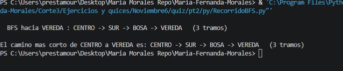

# Contexto del problema

Soy `Vereda`, tengo el color `Blanco` y voy despues del `Rojo`

Debemos hacer un programa que organice los colores en orden

### Niveles

```
1. centro - Azul
2. Oriente,Sur,Norte - Verde
3. Occidente,Chapinero,Bosa,Usaquen - Rojo
4. Vereda - Blanco
```

Mide cuantos tramos hace saliendo de `centro` hasta que llega a `vereda`, cuantos tramos recorre con un `recorrido BFS` es con cola

### CAMINO MAS CORTO desde CENTRO (en numero de tramos)

```
hacia BOSA      : CENTRO -> SUR -> BOSA   (2 tramos)
hacia USAQUEN   : CENTRO -> ORIENTE -> USAQUEN   (2 tramos)
hacia OCCIDENTE : CENTRO -> NORTE -> OCCIDENTE   (2 tramos)
```

### 
```
DFS hacia BOSA : CENTRO -> NORTE -> OCCIDENTE -> BOSA   (3 tramos)
BFS hacia BOSA : CENTRO -> SUR -> BOSA   (2 tramos)
```

### **BFS garantiza el minimo numero de tramos; DFS solo garantiza que llega.**

### **Tarea**: 
#### Cual es la complejidad de los modulos de recorrido `DFS` y `BFS`

# Evidencia de ejcución


